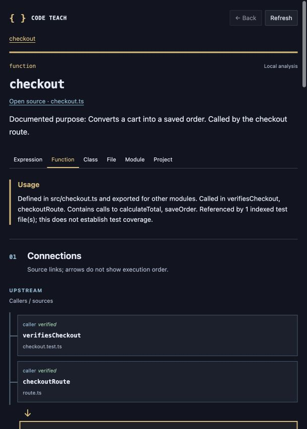

# Code Teach

A VS Code extension that explains Java, JavaScript/TypeScript, Python, HTML, and CSS as you explore a project. Hover a symbol for a short explanation, open **Explain more**, and follow its callers, dependencies, and data connections across indexed files and workspace packages.

This version uses local TypeScript analysis, language syntax trees, and source documentation. It does not call an AI service, transmit project code, execute project code, or modify source files. Explanations describe evidence available in source; they do not claim to observe runtime behavior.

## Run the extension

Development requires **Node.js 22 or newer**, npm, and **desktop VS Code 1.95 or newer**. Node 22 is required by the packaging tool. No API key or demo dependency installation is needed.

From this folder:

```sh
npm ci
npm run compile
```

Open this folder in VS Code and press **F5**, choosing **Run Code Teach demo**. The launch configuration compiles the extension and opens the included `demo` folder in an Extension Development Host. Open `src/checkout.ts` in that window and hover `checkout`.

For ongoing development, `npm run watch` recompiles changes. Restart the Extension Development Host to load changed extension code.

### Install a VSIX

```sh
npm run package
code --install-extension ./code-teach-0.3.2.vsix
```

Alternatively, use **Extensions → … → Install from VSIX…** in VS Code and choose the generated file. Open your project folder after installation. This installs Code Teach for your VS Code user profile, so it works in every supported project you open, including Java robot projects. If upgrading an already open window, use **Developer: Reload Window** once. The package includes the local analysis dependencies; the installed extension needs no separate `npm install`, JDK, Python runtime, or language-server extension.

## Explore a project

1. **Hover** a function, variable, class, parameter, or other identifiable symbol. The compact explanation includes purpose, project role, inputs, output, and relevant effects when found.
2. Choose **Explain more** for a persistent panel with a clickable connection map, numbered source steps, and real caller examples that map arguments to parameters. Each step explains a small piece of code; **Open line** selects it. Inputs, outputs, and side effects stay visible in a color-coded table. The full source preview and evidence expand on demand. **Open source** selects the supporting code in the editor.
3. Select **Upstream** to find what calls the code or supplies values. Select **Downstream** to find what it calls or where values are used. Each listed path is independently selectable.
4. Use **Back** or a breadcrumb to return. Navigation selects source without editing it. Revisiting an existing location collapses the current path to that step; recursion and import cycles never expand automatically.
5. Change scale with **Expression**, **Function**, **Class**, **File**, **Module**, or **Project**. Project/module overviews list indexed files and import connections. **Contents** drills into files, symbols, or class members.

The connection tree shows up to four callers/callees (or other available relationship kinds when there are no calls); the full Upstream/Downstream lists include data sources, consumers, and references. The chosen direction is remembered, and the current source step survives refreshes that keep the same symbol location. Branches, loops, deferred functions, and standard-array patterns are explained without running the project. Example arguments are written source expressions, not observed runtime values.

For JavaScript/TypeScript, a module means the nearest indexed named package, falling back to the selected file's directory. For the new languages it means the selected file's directory. Function/class scales use the enclosing declaration where one exists; unavailable scales are not invented. JavaScript/TypeScript expression analysis uses the expression at the caret or selection endpoint. Java/Python expression scope explains the containing declaration; HTML/CSS selects an element, rule, or property. Arbitrary multi-statement slices are not analyzed.

### A visual lesson, inside the editor

The panel uses flat study-note layouts: blue upstream branches, an ochre current symbol, green downstream branches, behavior tables, and source code paired with its explanation. Colors supplement the written relationship labels. Narrow panels stack the tree and source walkthrough vertically; light and dark editor themes are supported. Navigation, source links, and Back work across every lesson.



### Commands

| Command | Purpose |
| --- | --- |
| **Code Teach: Explain Selection** | Explain the symbol at the caret, or an expression when text is selected. Also available in the editor context menu. |
| **Code Teach: Explore Project** | Open an overview of the active workspace folder. Also available from the Code Teach status bar item. |
| **Code Teach: Refresh Index** | Rebuild the local index and refresh the current explanation. |

### Read the evidence

| Relationship | What it establishes |
| --- | --- |
| **caller** | A call site referencing this symbol, linked to its enclosing function or file. |
| **callee** | A call written inside the selected code, with its resolved declaration when available. |
| **data source** | A declaration used by an initializer or passed as an argument at a call site. |
| **consumer** | A use in another initializer or an argument passed to another call. |
| **import** | A module connection, including type-only imports when identifiable. |
| **reference** | Another use of the symbol, without assuming it is a call or a data-flow edge. |

**Verified** means a source relationship was resolved. It does not mean the code executes, an event fires, or a callback is invoked. **Inferred** marks an unresolved or indirect clue. Relationships without a resolved target are visible with an explanation but cannot be navigated.

Project-role descriptions use the definition's location, exports, callers, callees, and test references. Documentation supplies author intent and is labeled accordingly. Test references establish that a test mentions the symbol, not that it has adequate coverage. Project overviews link relevant indexed configuration and documentation; they do not guess the application's architecture or entry point.

## Language support

| Language | Navigation and teaching | Accuracy boundary |
| --- | --- | --- |
| JavaScript / TypeScript (including JSX/TSX) | Existing definitions, types, references, callers, callees, value connections, package aliases, source steps and examples | TypeScript source resolution; dynamic behavior remains uncertain |
| Java | Classes, fields, methods, parameters, imports, constructors, declared receiver chains, same-package and imported method candidates, Javadocs and source steps | Syntax-based candidates; no compiler type checking, inherited dispatch, overload type selection or Gradle execution |
| Python | Classes, functions, variables, imports/aliases, lexical and `self`/`cls` call candidates, docstrings and argument examples | No runtime execution or environment discovery; rebinding, decorators, arbitrary instance dispatch and search paths can change targets |
| HTML + CSS | Elements/attributes, rules/properties, linked local scripts/stylesheets, CSS imports, simple selector-to-element connections | Literal tag, `.class` and `#id` matching; no browser layout, cascade evaluation, templates or embedded script/style analysis |

Java/Python calls and variable-use candidates, and CSS matches, are explicitly **inferred**. JavaScript/TypeScript keeps its existing verified source links. A literal local resource or uniquely located relative module can have a verified source link; that still does not establish runtime execution. Absolute Python import targets are inferred because search paths are unknown. Unresolved calls remain visible with their source location.

All languages share the connection map, source snippets, argument tables where applicable, source links, upstream/downstream controls, breadcrumbs, Back, automatic edit refresh, progress, and cancellation. New-language steps are shallow examples of what is written, not an executed trace. See [language walkthroughs and unsupported cases](docs/languages.md).

## Privacy and exclusions

All analysis stays in the local extension host and its workers. **No code is transmitted to external AI, and there is no external AI mode or API-key setting.** The webview loads no remote resources. Installation and the integration-test runner may download development dependencies or VS Code; those downloads are separate from project analysis.

The index respects directory `.gitignore` and `.ignore` files, VS Code `files.exclude` and `search.exclude`, and additional `codeTeach.exclude` patterns. It excludes symlinks, common generated/vendor directories (`node_modules`, `vendor`, `dist`, `build`, coverage output, and others), common `*.generated.*` / `*.gen.*` / `*.g.*` files, minified files, source maps, environment files, common credential/key filenames, and lockfiles by default.

Secret exclusions are based on filenames and paths, not a credential detector. Secrets embedded in an otherwise eligible source file can still be read locally. Add exclusions for project-specific sensitive paths:

```json
{
  "codeTeach.exclude": ["internal/credentials/**", "fixtures/private/**"],
  "codeTeach.maxFiles": 1000,
  "codeTeach.maxFileKB": 256
}
```

The index includes eligible JavaScript/TypeScript, Java, Python, HTML and CSS sources, tests, package/compiler configuration, selected Gradle/Maven/Python configuration, and selected Markdown documentation. Python environments/caches, Gradle caches, `target`, compiled classes and bytecode are excluded. It does not index arbitrary binary assets or every file in a repository.

## Responsiveness and limits

The first request lazily collects a bounded index for its workspace folder. Subsequent hovers reuse it; they do not rescan or send the repository anywhere. Each workspace folder has its own worker and index. Multi-root folders are analyzed independently, so relationships between separate workspace roots are not resolved.

Unchanged files reuse parsed syntax trees and extracted facts. Edits invalidate cached explanations; the next query rebuilds semantic relationships across the indexed project. This is **not dependency-scoped incremental semantic analysis**. Unsaved source edits and filesystem changes refresh affected explanations. Hover requests have a 120 ms debounce; panel refreshes after edits have a 350 ms debounce.

Indexing exposes progress and cancellation. Queued analysis can be canceled; canceling an already-running worker query discards its result but does not preempt that synchronous computation. The editor remains separate from the worker, but later queries can wait for it to finish.

| Bound | Value |
| --- | --- |
| Source files per workspace folder | 1,000 by default; configurable from 1 to 5,000 |
| Text size per file | 256 KiB by default; configurable up to 1 MiB |
| Aggregate indexed text | 16 MiB per workspace folder |
| Context files | 100 per workspace folder |
| Directory entries examined | 50,000 per collection |
| Displayed relationships | Up to 60 per direction |
| Displayed child entries | Up to 60 |
| Teaching preview | Up to 12 steps (8 for Java/Python/HTML/CSS), 3 call examples, 12 parameters per example |
| Cached explanations | Up to 128 per language backend in each worker |
| Breadcrumb history | 50 visits |

Truncated indexes and relationships are identified in analysis notes. Missing paths may be outside the index, excluded, unresolved, or beyond a display bound. Panel timing reports analyzer execution time, not total hover latency. See [measured performance and methodology](docs/performance.md) for the tested workloads and limits.

## Unsupported cases

- Full runtime data flow, branch execution, scheduling, callback invocation, framework dependency injection, event routing, reflection, and computed dynamic imports.
- Build transforms, generated runtime behavior, and resolving every bundler-specific alias or package export condition.
- External dependency implementations in `node_modules`, standard-library declarations, and type declarations outside the eligible index. Some types and calls therefore remain unknown.
- Multiple compiler configurations in a monorepo. Only the root `tsconfig.json` or `jsconfig.json` supplies compiler options; save compiler-configuration changes before refreshing; nested configurations are not merged. Inherited configurations must themselves be indexed.
- Whole-repository architectural synthesis, natural-language AI tutoring, languages outside the support table, browser-hosted VS Code, and virtual filesystems.

Literal imports, source-level calls/references, root TypeScript path aliases, and eligible packages within the same workspace root are the primary navigation paths. Unresolved behavior remains explicit rather than being presented as a verified execution path.

## Validate

```sh
npm test
npm run test:integration
npm run benchmark
npm run benchmark:languages
npm run package
```

`npm test` runs focused analysis, cross-file navigation, edit refresh, history, exclusion, and panel security tests. Integration tests launch a separate desktop VS Code instance and may download its test runtime on first use. The benchmark prints measured query, cache, edit, and worker startup costs; it is not a performance guarantee for arbitrary projects.

Follow the [checkout demonstration](docs/demo.md) for the complete hover → upstream caller → downstream package → return flow.

See the [0.3.0 language audit and demos](docs/languages.md), [measured limits](docs/performance.md), and [earlier JS/TS feature audit](docs/audit.md).
