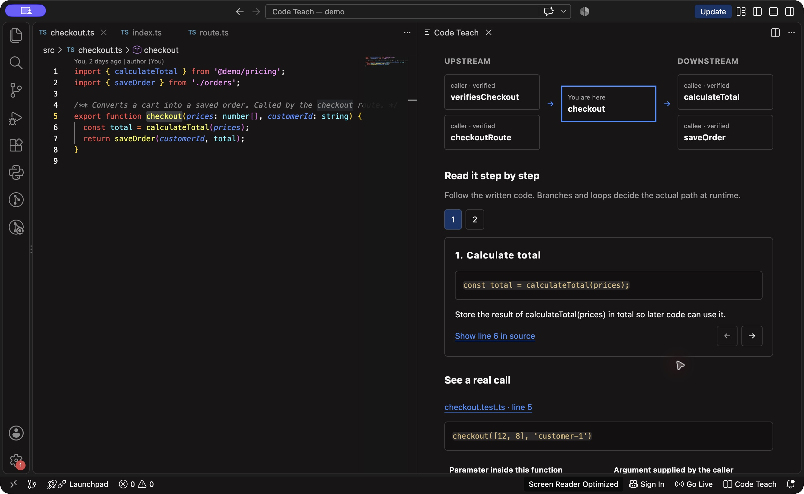
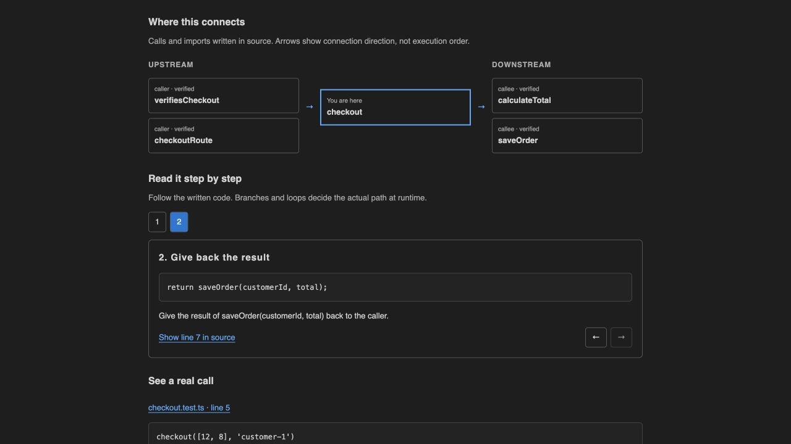

# Demonstration: follow a checkout

This small project has four connected pieces:

```text
src/route.ts                       src/checkout.test.ts
  checkoutRoute(request)             test caller
          \                            /
           v                          v
                 src/checkout.ts
                   checkout(...)
                    /         \
                   v           v
 packages/pricing/index.ts   src/orders.ts
      calculateTotal(...)     saveOrder(...)
```

The pricing import uses the root TypeScript path alias `@demo/pricing`. This makes the walkthrough exercise a package boundary as well as ordinary cross-file navigation. Orders live in an in-memory array; there is no database, server, or network setup.

## Start

From the extension folder, run `npm ci` and `npm run compile`. Open that folder in desktop VS Code and press **F5 → Run Code Teach demo**. In the resulting Extension Development Host, open `src/checkout.ts`.

## 1. Hover and understand the role

Hover the `checkout` declaration. Code Teach's hover describes its documented purpose: turn a cart into a saved order. Its source-backed project role identifies the containing file, upstream callers, and downstream work.

Choose **Explain more**. The persistent panel shows a clickable caller → checkout → dependency map. In **Read it step by step**, choose **1** to see `const total = calculateTotal(prices);`, then **2** to see `return saveOrder(customerId, total);`. **Show line in source** selects that exact statement.

Under **See a real call**, the test supplies `[12, 8]` to `prices` and `'customer-1'` to `customerId`. This is actual call-site source, not code executed by the extension. Inputs, outputs, and effects are in an expandable section. Documentation is author intent; the linked definitions and call sites establish the written connections. A call to `saveOrder` does not prove all of its effects at the `checkout` level—follow that dependency to investigate it.

## 2. Visit an upstream caller

Choose **Upstream**, then the **caller · verified** path named **checkoutRoute**. There can be more than one route into the function: the test file is another caller. Choose the route function for this walkthrough.

The panel now explains `checkoutRoute`, and the editor selects its definition in `src/route.ts`. Its call passes `request.prices` and `request.customerId` into `checkout`. The breadcrumb preserves the route back to `checkout`.

## 3. Return, then follow a downstream package

Choose **Back** to return to the `checkout` explanation and its source.

Choose **Downstream**, then the **callee · verified** path named **calculateTotal**. The editor opens `packages/pricing/index.ts`, following the `@demo/pricing` alias across the package boundary. The source step explains the `reduce` pattern: start with `0`, combine each price into the accumulated total, then return it. This explanation explicitly assumes the standard array method. For the test input, the arithmetic would be `0 + 12 + 8 = 20`; this is a worked illustration, not an observed execution. The explicit `number` return type is available under inputs/outputs.

`prices.reduce(...)` may have no navigable implementation because standard-library declarations are outside this version's index. That unresolved edge is an analysis limit; it is not proof that the call has no behavior.

Choose **Back** again. You are back at `checkout`, with its original context and available paths. Follow **saveOrder** to see the new order object, the array mutation, and the returned order as separate source steps. The mutation explanation states its standard-array assumption. Choose Back again to return, or select a different upstream caller.

## 4. Verify changes after edits

While the `checkout` explanation is open:

1. Add a comment above its declaration, without saving. The selected symbol's location is adjusted, and the panel refreshes after the edit debounce.
2. In `src/route.ts`, temporarily replace `return checkout(request.prices, request.customerId);` with `return request.customerId;`.
3. Return to the `checkout` panel and inspect **Upstream** after analysis completes. `checkoutRoute` should no longer appear as a caller. Its import may remain a separate **import** relationship; that is not a call. The independent test caller should remain.
4. Undo both edits. The caller path should return after refresh.

The extension only reads and selects source; these edits are made by you. For an automated check of navigation and unsaved-edit behavior, run `npm run test:integration` from the extension folder.

## Explore from the larger picture

Run **Code Teach: Explore Project**, then use **Explore inside** to select `src/checkout.ts` and its `checkout` symbol. **Module** shows the containing indexed package or directory. **File**, **Class**, **Function**, and **Expression** narrow the view where the selected source supports those scales.

Connections expand only when selected. Back and breadcrumbs retain the path, and revisiting a location collapses a cycle rather than expanding indefinitely. See the [README](../README.md) for exclusions and unsupported behavior and [performance measurements](performance.md) for measured limits.

## Verified native demo



The installed 0.2.1 extension was exercised in desktop VS Code: keyboard-triggered hover → Explain more → upstream checkoutRoute → Back → downstream calculateTotal in the pricing package → Back. Source-step navigation selected the corresponding statement in the editor. [The native hover](native-hover.png) now wraps prose naturally, and Explain more dismisses it before showing the panel. The demo reports no TypeScript problems under the installed TypeScript 6.0.3.

Automatic unsaved-edit and configuration refresh are verified by the real extension-host integration test, which uses a temporary copy of the demo.

## Browser layout preview



This additional image shows the real panel renderer in a local browser preview. That review also verified a 380 px layout with no horizontal overflow.
